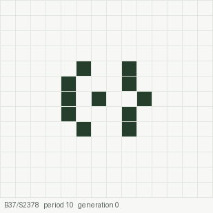
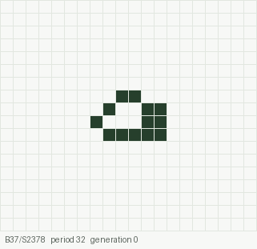
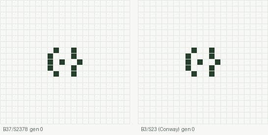
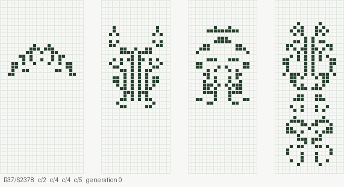
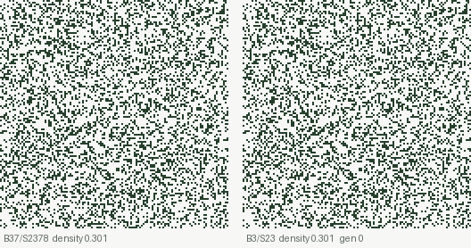
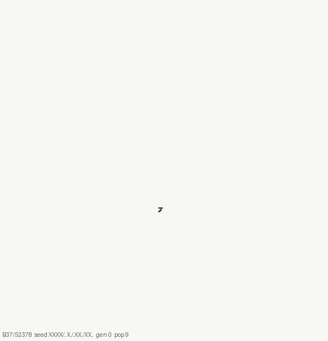

# The Life-like rule B37/S2378

[](https://doi.org/10.5281/zenodo.22974274)
[](https://github.com/joelcanary/life-like-rule-b37s2378/actions/workflows/ci.yml)
[](lean/)
[](LICENSE)
[](https://creativecommons.org/licenses/by/4.0/)

An exhaustive census of 4×4 seeds, disk-shaped growth, two oscillators with
machine-checked periods and four spaceships — for the outer-totalistic rule **B37/S2378**: a dead
cell is born with 3 or 7 live neighbours, a live cell survives with 2, 3, 7 or 8.
It is a close relative of DryLife (B37/S23).

This repository holds everything behind the note
**[*The Life-like rule B37/S2378*](paper/b37s2378-census-note.pdf)**
(Joel Cruz Cabrera, 2026, [doi:10.5281/zenodo.22974274](https://doi.org/10.5281/zenodo.22974274), all versions):
the LaTeX source, the raw data, the code that produced it, the Lean 4 proofs and
the animations below. Every number in the note is generated from `data/` by a
script; none is typed by hand.

The PDF in this repository is version 3 of the note
([doi:10.5281/zenodo.24160918](https://doi.org/10.5281/zenodo.24160918)), which adds the
still-life theorem below.

## Two oscillators Conway's rule does not have

<table>
<tr>
<td align="center"><br><b>p10</b>, 11 cells</td>
<td align="center"><br><b>p32</b>, 13 cells</td>
</tr>
</table>

Cells born in the current generation are drawn in teal. Both oscillators need
birth on 7: computed over their cycles, p10 works exactly in the rules from
B37/S238 to B378/S2378 and p32 from B37/S237 to B378/S2378
([`code/rango.py`](code/rango.py)). None of those six rules has a census on
Catagolue, and we found no earlier description of either oscillator.

```
#N p10 oscillator of B37/S2378 (11 cells)
x = 6, y = 5, rule = B37/S2378
bo2bo$o3bo$obo2bo$o3bo$bo2bo!

#N p32 oscillator of B37/S2378 (13 cells)
x = 6, y = 4, rule = B37/S2378
2b2o$bo2b2o$o3b2o$b5o!
```

The same 11 cells under B37/S2378 (left) and under Conway's B3/S23 (right):



### Machine-checked

[`lean/proofs/Lax834858Proofs/Oscillators.lean`](lean/proofs/Lax834858Proofs/Oscillators.lean)
proves, by kernel evaluation (`decide`, no `native_decide`):

| theorem | statement |
|---|---|
| `p10_period` | 10 steps of B37/S2378 return the p10 pattern to itself |
| `p10_period_minimal` | no smaller number of steps does |
| `p32_period` | 32 steps return the p32 pattern to itself |
| `p10_not_conway` | under B3/S23 the p10 pattern does not return within 10 steps |

`#print axioms` reports only `propext` for all four; CI checks it on every push with
[`lean/check_axioms.lean`](lean/check_axioms.lean).

The development follows the format of the Lax Lean Archive: [`lean/concepts/`](lean/concepts/)
*states* the four claims (declared there as `axiom`s, which is how the archive records a
statement) and [`lean/proofs/`](lean/proofs/) *proves* each one as a `theorem`, independently
of those declarations. The axiom audit confirms that no proof leans on them.
The archive rebuilt these proofs on its own machines and registered them on 14 November 2026
as **[`lax-834858`](https://laxarchive.org/lax-834858/)**, permanent and citable; the submitted
source is [joelcanary/lax-b37-oscillators](https://github.com/joelcanary/lax-b37-oscillators).

## Its finite still lifes are exactly Conway's

**Theorem.** A pattern with finitely many live cells is a still life of B37/S2378 if and only
if it is a still life of Conway's B3/S23. For infinite patterns it fails: the full plane is a
still life of B37/S2378 (every cell has 8 neighbours) but not of B3/S23.

The proof fits in a 3×3 block. If a finite still life of B37/S2378 had a live cell with 7 or 8
live neighbours, take the last one in reading order: its right or lower neighbour is alive
with at least 4 live neighbours inside the block, cannot have 7 or 8 (it comes later), and so
has 4–6, which B37/S2378 does not let survive. In the other direction, a dead cell with 7 live
neighbours would force an edge neighbour to be alive with at least 4, which Conway's rule does
not allow. So every count of Conway still lifes holds for B37/S2378 too, for instance the
still lifes of an n×n box ([OEIS A136278](https://oeis.org/A136278)).

The same two halves cover eight rules: B3/S23, B3/S237, B3/S238, B3/S2378, B37/S23, B37/S237,
B37/S238 and B37/S2378 all have the same finite still lifes. For DryLife (B37/S23) only the
second half is needed and finiteness is not: its still lifes, finite or not, are Conway's.

The DryLife half of this is a published comment on [OEIS A019473](https://oeis.org/A019473)
(the strict still lifes of Conway's Life): the still lifes of DryLife are exactly Conway's, so
A019473 counts both.

Checked three ways:

- **Lean 4**, [`lean/StillLifes.lean`](lean/StillLifes.lean): core Lean only, no Mathlib.
  `finite_stillLife_iff` is the theorem, `plane_counterexample` shows finiteness is needed,
  and `local_dense` / `local_dead` are the two block arguments, checked by `decide` over all
  2⁹ blocks with no axioms. The main theorem uses `propext`, `Classical.choice` and `Quot.sound`.
  The eight rules are formalized too, as one family `ruleLive s7 s8` / `ruleBorn b7`:
  `rule_finite_stillLife_iff` proves the theorem for all eight,
  `rule_stillLife_iff_of_no_dense_survival` proves the DryLife case for every configuration,
  finite or not, and `rule_plane_counterexample` shows that the four rules with S8 need
  finiteness. `ruleLive_b37` and `ruleBorn_b37` check that the family contains B37/S2378 as
  defined above. Same three standard axioms.
- **SAT**, [`code/ventana_extrema.py`](code/ventana_extrema.py): a 5×5 window around the last
  dense cell is unsatisfiable (CaDiCaL, proof checked by drat-trim); the same window without
  "last" is satisfiable, and so is the control rule B/S3458, whose full 3×3 block is a still life.
- **Brute force**: the 65,536 patterns of a 4×4 box are still lifes of both rules or of
  neither (83 of them are, A136278(4)).

## Four spaceships



Among finite patterns every difference from Conway's rule is in what moves, so we went looking
for spaceships. A row-by-row search for mirror-symmetric ships, in the style of
[Eppstein's gfind](https://arxiv.org/abs/cs/0004003), found these four (the search program
itself is not in this repository):

| RLE | speed | cells | box | works exactly in the rules from … to … |
|---|---|--:|---|---|
| [`c2.rle`](data/spaceships/c2.rle) | c/2 | 46 | 19×9 | B3/S237 – B378/S23678 |
| [`c4a.rle`](data/spaceships/c4a.rle) | c/4 | 111 | 15×23 | B37/S23 – B378/S2378 |
| [`c4b.rle`](data/spaceships/c4b.rle) | c/4 | 97 | 15×22 | B37/S237 – B378/S2378 |
| [`c5.rle`](data/spaceships/c5.rle) | c/5 | 177 | 15×40 | B37/S237 – B378/S2378 |

A ship works in a rule R exactly when the first rule ⊆ R ⊆ the second, birth and survival
separately (B0 left out). So the first c/4 also lives in DryLife (B37/S23), the c/2 needs
survival on 7 but not birth on 7, and the second c/4 and the c/5 need both. None of the four
works in Conway's rule.

**What the search rules out.** No mirror-symmetric ship of B37/S2378 moves at c/5 and is at
most 14 cells wide, and none moves at c/6 and is at most 12 cells wide, whatever its length
(width across the direction of travel, over all phases). The c/5 ship is 15 wide in every
phase, so no mirror-symmetric c/5 ship is narrower. This negative result comes from the search
program and is stated here, not reproduced; it says nothing about asymmetric ships. We know of
no c/6 ship of this rule.

**Earlier work.** [David Eppstein's database of life-like spaceships](https://www.ics.uci.edu/~eppstein/ca/)
(`glider.db`, checked on 20 November 2026) lists seven ships that also work in B37/S2378 (the
glider, a diagonal c/6, two orthogonal c/2 and one each at c/3, 2c/5 and c/4) and none of these
four. It has orthogonal c/5 ships in many other rules, but none that works in any rule from
B37/S237 to B378/S2378. We have not checked other catalogues, such as the ConwayLife forums,
LifeWiki or Catagolue, so we do not call these ships new.

**Checked.** [`code/naves.py`](code/naves.py) runs each ship until its shape comes back,
measures it in every phase, checks the mirror symmetry, computes the rule range from the
neighbour counts it actually uses, reruns it at both ends of the range and for 100 periods, and
writes [`data/spaceships.json`](data/spaceships.json); CI regenerates that file on every push.
[`tests/test_spaceships.py`](tests/test_spaceships.py) checks that no shorter period exists and
that each range is tight: dropping one count from the first rule, or adding one outside the
second, breaks the ship.

```
#N c/5 spaceship of B37/S2378 (177 cells)
#C Mirror-symmetric, found by a row-by-row search, November 2026.
x = 15, y = 40, rule = B37/S2378
4bo5bo$3bobo3bobo$2bob2o3b2obo$3bobo3bobo$6bobo$3b2obobob2o$b2o3bobo3b
2o$bobob2ob2obobo$4bobobobo$2bobobobobobo$2o2bobobobo2b2o$2o4bobo4b2o$
bo4bobo4bo$bo4bobo4bo$ob3obobob3obo$2b2obo3bob2o$2b2o7b2o$3bobo3bobo$
4b3ob3o$$4b2o3b2o$3b3o3b3o$$2bo2bo3bo2bo$3bobo3bobo$$3bo7bo$2b4o3b4o$b
o3b2ob2o3bo$b2o4bo4b2o$b3obo3bob3o$4bo5bo$4b3ob3o$6bobo$2bob2o3b2obo$b
o11bo$bo3bo3bo3bo$5bo3bo$2bo2bo3bo2bo$4bo5bo!
```

## Soups settle denser than in Conway's rule



Same random start (density 0.30, torus), both rules. Over 40 soups of side 128,
B37/S2378 settles at a density of **0.122** against **0.052** for B3/S23.

## Seeds that do not settle grow as a disk



Of 471 sampled unsettled 4×4 seeds, 338 are still growing after 1,000
generations; under Conway's rule none of 465 keeps growing. The growth is a disk
whose core holds the density of settled soup (0.111–0.130) and whose edge
advances at 0.056–0.065 cells per generation, shedding gliders.

## The census

Every one of the 51,472 seeds whose bounding box is exactly 4×4, evolved until it repeats
up to translation, for both rules (the other 14,063 non-empty patterns of the box are
translates of seeds of smaller boxes):

| class | B37/S2378 objects | occurrences | B3/S23 objects | occurrences |
|---|--:|--:|--:|--:|
| still life | 66 | 27,917 | 55 | 22,676 |
| oscillator, p = 2 | 26 | 9,000 | 24 | 7,972 |
| oscillator, p = 3 | 1 | 24 | 1 | 48 |
| oscillator, p = 10 | 1 | 8 | – | – |
| oscillator, p = 32 | 1 | 8 | – | – |
| spaceship, p = 4 (glider) | 1 | 752 | 1 | 728 |

Objects are counted up to symmetry and phase; cells within Chebyshev distance 3
belong to the same object.

## The 5×5 census (in this repository, not in the note)

The same census for the 29,671,936 seeds whose bounding box is exactly 5×5 (577 times as
many), run with [`code/censo.c`](code/censo.c) and aggregated by
[`code/agrega_censo.py`](code/agrega_censo.py) with the Python classifier of the 4×4
census. **It finds no new object specific to B37/S2378.**

| | B37/S2378 | B3/S23 |
|---|--:|--:|
| extinct | 6,139,972 | 7,135,655 |
| unsettled after 100 generations | 11,233,712 (37.9 %) | 7,827,644 (26.4 %) |
| settled | 12,298,252 | 14,708,637 |
| distinct objects (symmetry and phase merged) | 5,222 | 4,730 |

Most of those objects are composites: two or more objects that stopped within distance 3 of each
other and so count as one under the census rule. [`code/fases_5x5.py`](code/fases_5x5.py)
separates them (groups that evolve independently, each recurring on its own, are separate
objects) and gives every simple oscillator its rule range. What is left, for periods of 3 and
above:

| simple object | B37/S2378 seeds | B3/S23 seeds | smallest rule it works in |
|---|--:|--:|---|
| glider | 388,176 | 338,288 | (spaceship) |
| lightweight, middleweight, heavyweight spaceships | – | 3,432 / 824 / 784 | (spaceships) |
| pulsar, p3 | 42,476 | 39,290 | B3/S23 |
| Mold, p4 | 24 | – | B3/S23 |
| pulsar with a blinker it interacts with, p6 | 40 | 44 | B3/S23 |
| pentadecathlon, p15 | – | 48 | B3/S23 |
| **the p10 above** (alone, or with a block it interacts with) | 2,448 + 8 | – | B37/S238 |
| **the p32 above** | 4,504 | – | B37/S237 |

The period-4 oscillator reached from 24 seeds under B37/S2378 looked new until its rule range
came out: it works from B3/S23 upwards, and it is Mold, a Conway oscillator that no 5×5 seed
happens to reach under Conway's rule. So the only objects specific to B37/S2378 are still the
p10 and the p32, and the glider is still the only spaceship it reaches (the four larger ones
above come from a search, not from seeds): the three orthogonal spaceships that Conway's census
finds from the same seeds do not survive birth on 7.

## Repository layout

| folder | contents |
|---|---|
| [`paper/`](paper/) | the note (PDF and LaTeX), the generated table, figures and numeric macros, `datos_nota.py` that generates them, RLE files |
| [`data/`](data/) | JSON outputs of every computation; the four spaceships as RLE in [`data/spaceships/`](data/spaceships/) |
| [`code/`](code/) | the scripts that produced `data/`, `censo.c` + `agrega_censo.py` (the 5×5 census), `fases_5x5.py` (its objects), `rango.py` (rule ranges), `ventana_extrema.py` (the SAT check of the still-life theorem), `naves.py` (the spaceships and their GIF) and `animaciones.py` (the other GIFs) |
| [`lean/`](lean/) | the Lean 4 development: the oscillators (`concepts/` and `proofs/`) and the still-life theorem (`StillLifes.lean`) |
| [`animations/`](animations/) | the GIFs, regenerated by `code/animaciones.py` |
| [`tests/`](tests/) | unit tests (Python `unittest`) |
| [`.github/workflows/`](.github/workflows/) | CI: tests, regeneration, LaTeX build, Lean build and axiom audit |

Identifiers and comments inside `code/` are in Spanish; the note and this README are in English.

## Tests

```sh
pip install -r requirements.txt
python -m unittest discover -s tests -v
```

46 tests, a few seconds. They check:

- **the method against Conway's rule first**: block and beehive are still lifes, blinker and
  toad have period 2, the glider is a period-4 diagonal spaceship, the R-pentomino has not
  settled by generation 100;
- **the two oscillators**: periods 10 and 32, p10 not periodic under B3/S23, every rule in
  the computed range sustains p10 and dropping B7 breaks it;
- **the Lean encoding against the Python one**: the boards in the Lean files crop to the
  census oscillators, the pattern never reaches the board's border during its cycle, and the
  proofs contain no `sorry`, `native_decide`, `admit` or `axiom`;
- **the data**: the census evolved exactly the 51,472 seeds whose bounding box is 4×4 and
  every one of them is accounted for, periods 10 and 32 occur only
  in B37/S2378, the growth classes add up to the sample;
- **the 5×5 census**: it evolved exactly the 29,671,936 seeds with a 5×5 bounding box
  (inclusion–exclusion), the composite detector keeps a glider and the p10 whole and splits a
  blinker from a distant block, the census p4 is Mold and works in Conway's rule, the only
  objects specific to B37/S2378 are the p10 and the p32, and the Conway control finds the
  glider, the three orthogonal spaceships and the pentadecathlon;
- **the still-life theorem**: the two 3×3 block arguments case by case, the 4×4 brute force,
  the Lean file has no escape hatches, and (when `cadical` and `drat-trim` are installed) the
  SAT window is unsatisfiable with a verified proof while its two controls are satisfiable;
- **the note**: the RLE files decode to the census patterns, `cifras.tex`, the table and the
  RLE files regenerate identically from `data/`, and no generated value is typed by hand in
  `nota.tex`.

[CI](.github/workflows/ci.yml) runs them on every push, regenerates the note's numbers from
`data/`, compiles the LaTeX, builds the Lean proofs against the pinned Mathlib and audits their
axioms, including those of `lean/StillLifes.lean`.

## Reproduce

Python 3.12 with the versions pinned in [`requirements.txt`](requirements.txt); a LaTeX
distribution for the note; Lean `v4.33.0` for the proofs. With those versions the figures and
the GIFs regenerate byte for byte; the numbers do not depend on library versions.

```sh
# the note: numbers, table and figures from data/, then LaTeX
cd paper && python datos_nota.py && pdflatex nota.tex && pdflatex nota.tex

# the animations (a few seconds on one core)
cd code && python animaciones.py

# the proofs
cd lean/proofs && lake exe cache get && lake build
lake env lean ../StillLifes.lean     # the still-life theorem (core Lean, prints its axioms)

# the SAT check of the still-life theorem (needs cadical and drat-trim)
cd code && python ventana_extrema.py
```

Recomputing `data/` from scratch (the 4×4 census takes about 20 minutes on one core):

```sh
cd code
python censo_b37.py 4 4 --gens 100 --sopas 40
python censo_b37.py 4 4 --gens 100 --sopas 40 --regla B3/S23
python crecimiento.py 4 4 --regla B37/S2378 --gens 100 --lejos 1000 --muestra 25
python crecimiento.py 4 4 --regla B3/S23 --gens 100 --lejos 1500 --muestra 20
python lejos.py --regla B37/S2378 --de ../data/crecimiento-b37-s2378-4x4.json --lejos 5000 --muestra 34
python lejos.py --regla B3/S23 --de ../data/crecimiento-b3-s23-4x4.json --lejos 20000
python frente.py '["XXXX","..X.",".XX.","XX.."]' 1600 2400 frente-1.json
python rango.py
```

Outputs are written next to the scripts; move them to `data/` to rebuild the note from them.

## Cite

```bibtex
@misc{cruzcabrera2026b37s2378,
  author    = {Cruz Cabrera, Joel},
  title     = {The Life-like rule {B37/S2378}: an exhaustive census of $4\times4$ seeds,
               disk-shaped growth, and two oscillators with machine-checked periods},
  year      = {2026},
  publisher = {Zenodo},
  doi       = {10.5281/zenodo.22974274},
  url       = {https://doi.org/10.5281/zenodo.22974274}
}
```

GitHub's "Cite this repository" button reads [`CITATION.cff`](CITATION.cff).

## Corrections

**v2 (26 September 2026).** Version 1 of the note said the census evolved all 65,535
non-empty patterns of the 4×4 box. It evolves the 51,472 whose bounding box is exactly 4×4;
the other 14,063 are translates of smaller seeds and are skipped on purpose. The share of
unsettled seeds is therefore 22.8 % (B37/S2378) and 18.0 % (B3/S23), not 17.9 % and 14.2 %.
Every object, oscillator, table entry and growth figure is unchanged.
[`code/completa_censo.py`](code/completa_censo.py) adds the exact count to the census files
and `censo_b37.py` now writes it. Found while porting the census to C for the 5×5 box.

## Licences

Code and Lean development: [Apache License 2.0](LICENSE).
The note (PDF and LaTeX source in `paper/`) and the animations:
[Creative Commons Attribution 4.0](https://creativecommons.org/licenses/by/4.0/).

The computations, scripts and a first draft of the note were prepared with the
help of an AI assistant (Claude, Anthropic); the author reviewed the results and
is responsible for the content.
